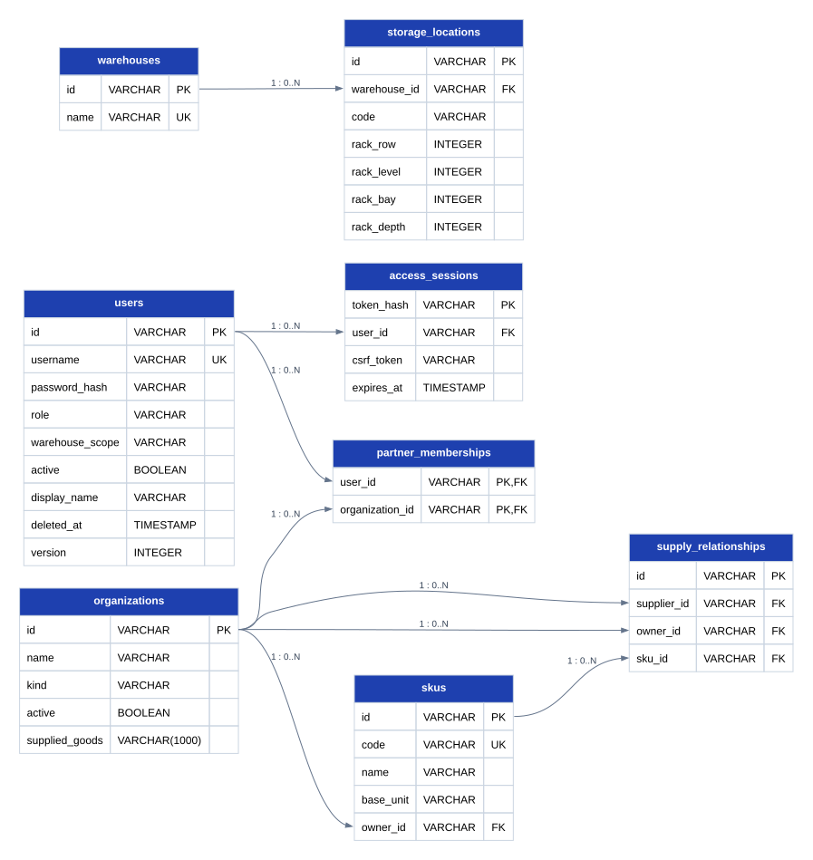
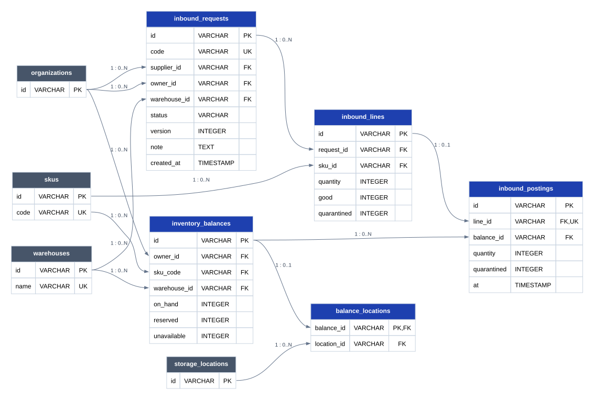
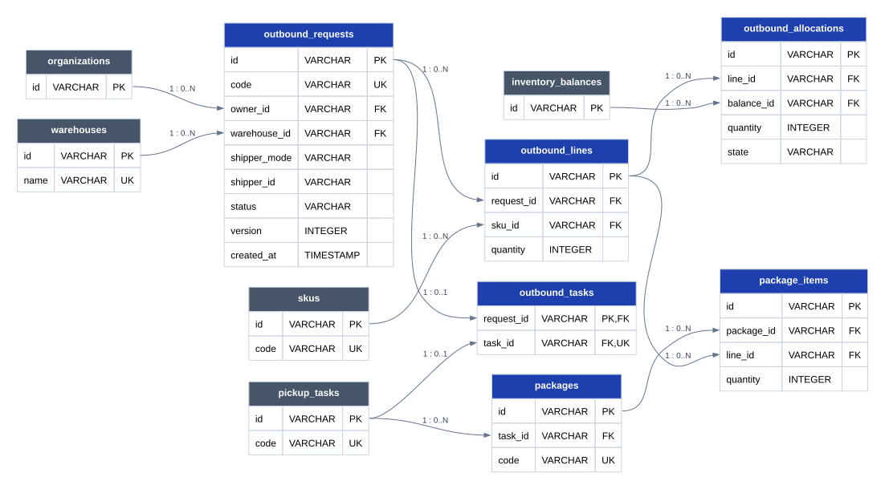
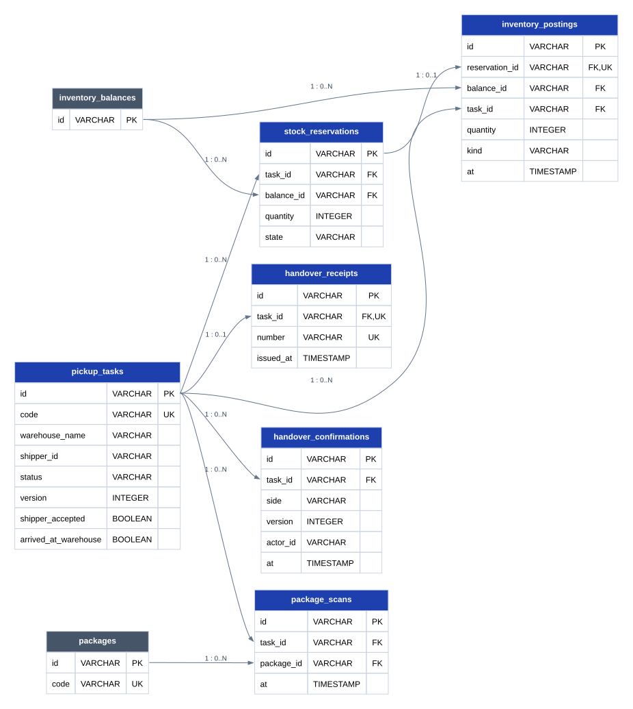
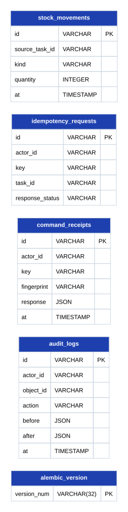
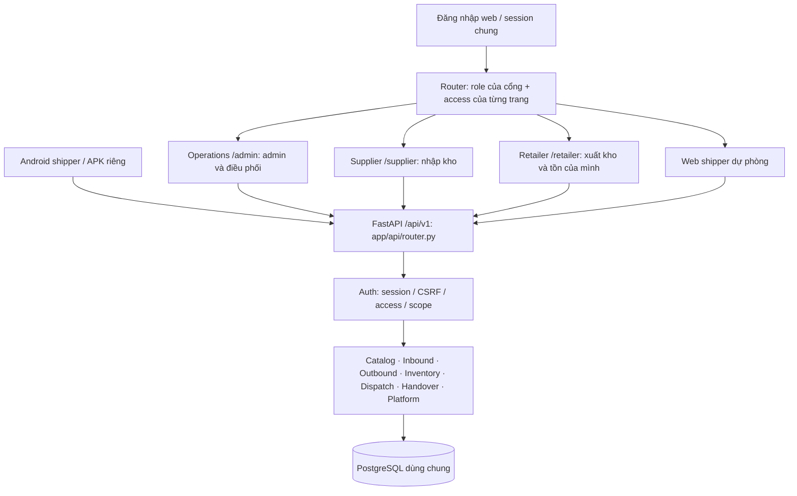
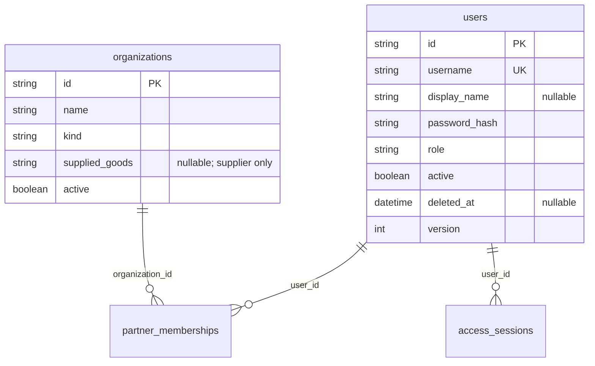
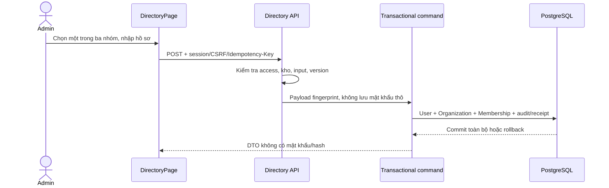

# DistriFlow — báo cáo triển khai PostgreSQL

Mã nguồn: [distriflow](./distriflow). Báo cáo nằm ngoài folder code. Cập nhật ngày 26/11/2026.

## 1. Trạng thái thực tế và nguồn dữ liệu

Theo lựa chọn của bạn: **PostgreSQL trống để tự nhập dữ liệu qua giao diện**, không chuyển dữ liệu demo và không dựng số liệu kinh doanh.

- PostgreSQL đã chạy bằng container riêng, chỉ bind localhost cổng **55432**.
- Phiên bản quan sát: **PostgreSQL 16.15**, schema Alembic **20261126_04**.
- Chỉ chuyển **5 tài khoản và password hash hiện có** từ SQLite, giữ mật khẩu bạn đã cập nhật. Không chuyển session hoặc phạm vi kho/đối tác demo.
- Tất cả bảng nghiệp vụ đang trống: kho, tổ chức, SKU, vị trí, cung ứng, tồn, nhập, xuất, nhiệm vụ, kiện và biên nhận đều **0 bản ghi** tại thời điểm kiểm tra.
- SQLite cũ và các backup vẫn giữ nguyên; chưa xóa hoặc sửa dữ liệu nghiệp vụ cũ.
- Dashboard đọc database; không có dữ liệu thì hiển thị 0/trống. KPI là toàn bộ phiếu trong kho; biểu đồ là 30 ngày gần nhất. Giao diện ghi rõ nguồn database và thời điểm tải.

Bằng chứng số lượng từng bảng: [database-status.json](./docs/database-status.json). Đây là ảnh chụp trạng thái có timestamp, không phải dữ liệu live sau khi bạn bắt đầu nhập. Đọc lại bất kỳ lúc nào:

~~~powershell
cd distriflow/backend
python -m app.setup.status
~~~

**Chưa có dữ liệu nghiệp vụ thật được cung cấp.** Không gọi dữ liệu test/demo là dữ liệu thật. Các tên, SKU và số lượng trong bộ kiểm thử chỉ là fixture ở database kiểm thử, không nằm trong database sử dụng.

## 2. Những gì đã sửa

- Chuyển cấu hình runtime sang PostgreSQL qua psycopg; bỏ fallback tự động về SQLite.
- Thêm Alembic với revision DDL cố định; startup chỉ nâng schema, không tự seed.
- Thêm foreign key thật cho chủ hàng/SKU/kho của inventory_balances.
- Tách seed demo thành app/demo_seed.py, chỉ cho phép chạy khi chỉ định SQLite và xác nhận demo. app/seed.py nay chỉ tương thích lệnh cũ bằng cách migrate schema, không chèn dữ liệu.
- Thêm bootstrap chỉ chuyển tài khoản/hash; từ chối target đã có dữ liệu, không copy chứng từ/tồn.
- Thêm khai báo kho đầu tiên trên giao diện và quản lý phạm vi tài khoản/membership, để bạn tự cấu hình từ database trống.
- Tách frontend admin thành dashboard, dispatch, handover; admin chỉ giữ layout.
- Tách schema khỏi router của auth/catalog/inventory; tách session service, tồn kho service, dashboard và audit thành file riêng.
- Giữ luồng nhập → giữ hàng → soạn/đóng kiện → shipper → xác nhận kho; xuất tồn theo số lượng SKU, không theo số kiện.
- Giữ CSRF, access policy, scope, version, idempotency và audit transaction.

Hướng dẫn Sites được áp dụng ở chế độ local cho phần giao diện: giữ Vue/thiết kế hiện có, bổ sung trạng thái trống và kiểm thử responsive. Không publish lên hosting ngoài.

## 3. Cách chạy

Docker Desktop cần đang chạy. Từ thư mục gốc:

~~~powershell
# Bật PostgreSQL riêng của dự án
docker compose --env-file distriflow/infra/.env -f distriflow/infra/compose.yaml up -d db

# Terminal backend: migrate rồi chạy, KHÔNG seed demo
.\distriflow\backend\start.ps1

# Terminal frontend
.\distriflow\frontend\start.ps1
~~~

- Giao diện: http://127.0.0.1:5173/login
- API: http://127.0.0.1:8000/docs
- Liveness: http://127.0.0.1:8000/health
- Database readiness: http://127.0.0.1:8000/health/ready
- Không chạy thêm tiến trình cùng cổng nếu đã có ứng dụng đang chạy.

### Cấu hình

- backend/.env chứa DATABASE_URL tới PostgreSQL localhost:55432 và COOKIE_SECURE.
- infra/.env chứa mật khẩu PostgreSQL riêng; cả hai file đã loại khỏi Git.
- Ví dụ cấu hình: [backend/.env.example](./distriflow/backend/.env.example), [infra/.env.example](./distriflow/infra/.env.example).
- Biến môi trường shell có độ ưu tiên cao hơn .env. Không chia sẻ URL có mật khẩu.
- Dùng COOKIE_SECURE=true khi có HTTPS.
- Tài khoản local: [accounts.local.json](./distriflow/backend/accounts.local.json), không đưa vào Git.

Sửa password trong JSON **không tự đổi password hash trong PostgreSQL**. Đổi mật khẩu tương tác:

~~~powershell
cd distriflow/backend
python -m app.manage password admin
~~~

Lệnh thu hồi session cũ; không tự sửa file JSON. Các mật khẩu bạn đã yêu cầu đồng bộ trước đó được giữ khi chuyển tài khoản.

### Cài máy mới

Python 3.12+, Node 22/pnpm 9, Docker Desktop:

~~~powershell
cd distriflow/backend
python -m pip install -r requirements.txt
# Cấu hình backend/.env, infra/.env và bật PostgreSQL trước
python -m app.setup.migrate
cd ../frontend
corepack pnpm install --frozen-lockfile
~~~

Bootstrap tài khoản chỉ cần khi tạo database mới có sẵn SQLite nguồn và chủ đích giữ tài khoản:

~~~powershell
cd distriflow/backend
python -m app.setup.bootstrap --accounts-from-sqlite distriflow.db
~~~

**Không chạy lại bootstrap trên database đang dùng.** Nó từ chối nếu target đã có bất kỳ record nào; không xóa hoặc ghi đè để ép nhập.

## 4. Nhập dữ liệu thật lần đầu

1. Đăng nhập admin, vào **Danh mục & vị trí → Kho**, nhập tên kho thực tế. Tài khoản admin được gán kho vừa khai báo; chưa hỗ trợ admin tạo thêm nhiều kho ngoài scope.
2. Vào **Đối tác**, nhập supplier và chủ hàng/retailer thật.
3. Trong Danh mục, nhập **SKU + tên hàng + đơn vị cơ sở**, **vị trí kho**, **quan hệ supplier/chủ hàng/SKU**.
4. Vào **Tài khoản & phạm vi**, gán kho cho dispatch/shipper; gán kho và đúng tổ chức cho supplier/retailer. Tài khoản được thay đổi cần đăng nhập lại.
5. Supplier hoặc admin tạo yêu cầu nhập; admin duyệt, kiểm nhận hàng tốt/cách ly và xác nhận vị trí cất. Chỉ bước cất hàng mới tăng tồn.
6. Retailer hoặc admin tạo yêu cầu xuất; admin duyệt giữ hàng, soạn và đóng kiện.
7. Điều phối gán shipper nếu chọn DistriFlow. Shipper nhận, báo đến kho, đối chiếu đủ mã và xác nhận.
8. Admin xác nhận tại kho: xuất đúng lượng SKU và tạo một biên nhận trong cùng transaction.

Không có nút tự sinh tồn đầu kỳ giả. Nếu cần tồn đầu kỳ, cần chứng từ nhập phản ánh số lượng kiểm đếm thật. Hiện không có import Excel/CSV tự động.

## 5. Cấu trúc file theo module

~~~text
Class/
  README.md
  docs/
    database-status.json             Bằng chứng metadata/số lượng thực tế
    screenshots/
  distriflow/
    backend/
      app/
        main.py                      Bootstrap API, routers, error/health
        models.py                    Registry SQLAlchemy
        core/
          config.py                  .env và cấu hình
          database.py                Engine/session, pool pre-ping
          commands.py                Transaction, replay và audit
          schemas.py                 Version và dòng hàng dùng chung
        setup/
          migrate.py                 Alembic upgrade
          bootstrap.py               Chuyển account hash, không nghiệp vụ
          status.py                  Đọc metadata/số lượng, không secrets
          schema_report.py           Đọc schema PostgreSQL vật lý
          schema_render.py           Sinh từ điển/ERD từ metadata
        modules/
          auth/
            models.py access.py schemas.py service.py router.py scopes.py
          catalog/
            models.py schemas.py service.py router.py
          inbound/
            models.py schemas.py service.py router.py
          outbound/
            models.py schemas.py service.py router.py
          inventory/
            models.py schemas.py service.py router.py
          dispatch/
            models.py schemas.py projections.py service.py commands.py router.py
          handover/
            models.py schemas.py service.py router.py
          platform/
            dashboard.py audit.py router.py
        manage.py                    Đổi mật khẩu tương tác
        seed.py                      Migrate-only, không chèn demo
        demo_seed.py                 Demo SQLite có chốt xác nhận
      migrations/
        env.py script.py.mako
        versions/20261123_01_initial_schema.py
      alembic.ini
      tests/
        test_access.py test_workflow.py test_onboarding.py
        run_postgres.py              Database kiểm thử riêng
        test_schema_report.py        Kiểm tra ERD/từ điển không bịa FK
        serve_e2e.py                 API E2E với SQLite cô lập
      start.ps1 requirements.txt
    frontend/src/
      app/access.ts                  Session và can(permission)
      router/index.ts                Guard tất cả matched routes
      features/
        admin/AdminLayout.vue        Shell quản trị
        dashboard/                   DashboardPage, FlowChart
        dispatch/                    Điều phối
        handover/                    List, detail, TaskTable, useOperations
        auth/                        Login, forbidden
        accounts/                    Gán kho và tổ chức tài khoản
        catalog/                     Danh mục, kho và đối tác
        inbound/ outbound/           Chứng từ nhập/xuất
        inventory/                   Tồn và lịch sử
        shipper/                    Giao diện shipper web dự phòng
      portals/                       Routes riêng operations/supplier/retailer/shipper
      shared/layouts/                Shell dùng chung cho layout supplier/retailer
      shared/api/                    HTTP/CSRF/idempotency
      shared/components/             Form/bảng/trạng thái
      shared/types/                  DTO
    contracts/
      openapi.json
      schema.postgresql.sql          SQL sinh từ revision Alembic
    infra/
      compose.yaml .env.example
~~~

### Kiến trúc hệ thống

~~~mermaid
flowchart TB
    U[Admin / Điều phối / Supplier / Retailer / Shipper] --> FE[Vue 3 / TypeScript]
    FE --> RG[Route guard / access]
    FE --> HTTP[HTTP / cookie / CSRF / command key]
    HTTP -->|/api/v1| API[FastAPI routers + schemas]
    API --> AUTH[Auth / quyền / kho / membership]
    AUTH --> CAT[Catalog]
    AUTH --> IN[Inbound]
    AUTH --> OUT[Outbound]
    AUTH --> DIS[Dispatch]
    AUTH --> HAN[Handover]
    AUTH --> PL[Dashboard / Audit]
    OUT --> DIS
    IN --> INV[Inventory service]
    OUT --> INV
    HAN --> INV
    CAT --> CMD[Transaction / replay / audit]
    IN --> CMD
    OUT --> CMD
    DIS --> CMD
    HAN --> CMD
    CMD --> PG[(PostgreSQL 16 / dữ liệu sử dụng)]
    INV --> PG
    PL --> PG
    MIG[Alembic / frozen revisions] -->|DDL| PG
    TEST[API tests] --> TPG[(distriflow_module_tests)]
    E2E[Browser workflow fixtures] --> TS[(SQLite E2E riêng)]
~~~

Test không dùng database nghiệp vụ để ghi chứng từ. Kiểm thử live PostgreSQL chỉ đăng nhập, đọc trạng thái trống rồi logout.

## 6. Các bảng PostgreSQL và ERD đã đối chiếu

Đối chiếu trực tiếp ngày **26/11/2026** trên schema `public`: **30 bảng vật lý**, **153 cột**, **40 FOREIGN KEY**. Trong đó có 29 bảng ứng dụng (bao gồm bảng hạ tầng/legacy) và 1 bảng `alembic_version`. Migration `20261126_04` đang ở `head`; Alembic check không phát hiện lệch model/schema. Không chèn dữ liệu mẫu khi kiểm tra.

Nguồn kiểm chứng: [metadata database-schema.json](./docs/database-schema.json), [DDL đang tồn tại trong PostgreSQL](./distriflow/contracts/schema.postgresql.live.sql), [migration SQL để khởi tạo](./distriflow/contracts/schema.postgresql.sql). Toàn bộ cột và ràng buộc được mô tả ở **mục 11** cuối báo cáo.

### Cách đọc sơ đồ

- PK: khóa chính; FK: khóa ngoại; UK: UNIQUE một cột. Các khóa ghép được ghi riêng trong từ điển dữ liệu, không hiểu nhầm từng cột là duy nhất.
- Mũi tên đi từ bảng được tham chiếu tới bảng chứa FK, nhãn `1 : 0..N` hoặc `1 : 0..1` theo ràng buộc vật lý. Chưa có record con không có nghĩa database sai.
- Bảng xanh thuộc nhóm đang xem; bảng xám là bảng tham chiếu được rút gọn PK/UK để nối giữa các nhóm. Cùng tên bảng ở các ảnh là cùng một bảng trong database.
- SVG là vector: bấm ảnh hoặc mở liên kết ảnh để phóng to, không mất nét. Không cần plugin Mermaid để xem ảnh.
- Mã [Mermaid ERD đầy đủ](./distriflow/contracts/database.erd.mmd) dùng ký pháp theo [tài liệu Mermaid](https://mermaid.js.org/syntax/entityRelationshipDiagram.html). Ảnh được render tại máy bằng Graphviz/WASM, không gửi schema lên dịch vụ ngoài.

### Tài khoản và danh mục

[](./docs/diagrams/erd-catalog.svg)

| Bảng có thật trong PostgreSQL | Mục đích | Khóa chính |
| --- | --- | --- |
| `users` | Tài khoản, hash mật khẩu, vai trò và phạm vi kho. | `id` |
| `access_sessions` | Phiên đăng nhập và CSRF. | `token_hash` |
| `organizations` | Tổ chức supplier/retailer. | `id` |
| `partner_memberships` | Tài khoản thuộc tổ chức nào. | `user_id, organization_id` |
| `warehouses` | Kho. | `id` |
| `storage_locations` | Vị trí lưu hàng. | `id` |
| `skus` | Danh mục mã hàng và đơn vị cơ sở. | `id` |
| `supply_relationships` | SKU được supplier cung cấp cho chủ hàng. | `id` |

### Nhập kho và số dư

[](./docs/diagrams/erd-inbound.svg)

| Bảng có thật trong PostgreSQL | Mục đích | Khóa chính |
| --- | --- | --- |
| `inbound_requests` | Phiếu yêu cầu nhập. | `id` |
| `inbound_lines` | Dòng hàng và số lượng kiểm nhận. | `id` |
| `inbound_postings` | Bút toán tăng tồn. | `id` |
| `inventory_balances` | Số dư tồn, lượng giữ, không khả dụng. | `id` |
| `balance_locations` | Vị trí của dòng số dư. | `balance_id` |

### Xuất kho và đóng kiện

[](./docs/diagrams/erd-outbound.svg)

| Bảng có thật trong PostgreSQL | Mục đích | Khóa chính |
| --- | --- | --- |
| `outbound_requests` | Phiếu yêu cầu xuất. | `id` |
| `outbound_lines` | Dòng hàng xuất. | `id` |
| `outbound_allocations` | Phân bổ giữ hàng. | `id` |
| `outbound_tasks` | Nối phiếu xuất với nhiệm vụ. | `request_id` |
| `packages` | Kiện hàng. | `id` |
| `package_items` | Nội dung/số lượng hàng trong kiện. | `id` |

### Bàn giao và ghi xuất

[](./docs/diagrams/erd-handover.svg)

| Bảng có thật trong PostgreSQL | Mục đích | Khóa chính |
| --- | --- | --- |
| `pickup_tasks` | Nhiệm vụ giao nhận. | `id` |
| `stock_reservations` | Reservation theo nhiệm vụ. | `id` |
| `inventory_postings` | Bút toán xuất tồn. | `id` |
| `package_scans` | Đối chiếu mã kiện. | `id` |
| `handover_confirmations` | Xác nhận shipper/kho cùng version. | `id` |
| `handover_receipts` | Biên nhận bàn giao. | `id` |

### Hạ tầng và legacy

[](./docs/diagrams/erd-infrastructure.svg)

| Bảng có thật trong PostgreSQL | Mục đích | Khóa chính |
| --- | --- | --- |
| `audit_logs` | Nhật ký trước/sau thao tác. | `id` |
| `command_receipts` | Chống lặp lệnh và replay kết quả. | `id` |
| `stock_movements` | Lịch sử tồn legacy. | `id` |
| `idempotency_requests` | Chống lặp legacy. | `id` |
| `alembic_version` | Phiên bản schema. | `version_num` |

### ERD tổng thể và giới hạn được ghi đúng thực tế

[Mở ERD toàn bộ 30 bảng](./docs/diagrams/erd-full.svg). Các file [DOT](./docs/diagrams/erd-full.dot) và [Mermaid](./distriflow/contracts/database.erd.mmd) có thể chỉnh sửa/tái xuất.

`users.warehouse_scope`, `pickup_tasks.warehouse_name`, `pickup_tasks.shipper_id`, `outbound_requests.shipper_id` và các actor/object ID dạng chuỗi **chưa có FK vật lý** nếu không được liệt kê trong metadata. ERD không tự nối chúng như đã có ràng buộc. `status`, `kind`, `side` là cột chuỗi, không phải PostgreSQL ENUM. Hai bảng legacy được giữ lại, không xóa lịch sử.

`inventory_balances` có CHECK không âm và đủ lượng giữ; reservation phải dương. Biên nhận duy nhất theo nhiệm vụ, ghi xuất duy nhất theo reservation và nhập duy nhất theo dòng nhập. Mục 11 liệt kê chính xác CHECK/UNIQUE/FK/index thực tế, không suy diễn thêm ràng buộc chưa triển khai.

## 7. Class và luồng transaction

~~~mermaid
classDiagram
    class InboundRequest {
        status: string
        version: int
    }
    class OutboundRequest {
        status: string
        version: int
        shipper_mode: string
    }
    class PickupTask {
        shipper_id: string
        status: string
        version: int
    }
    class InventoryBalance {
        on_hand: int
        reserved: int
        unavailable: int
    }
    class StockReservation {
        quantity: int
        state: string
    }
    class Receipt {
        number: string
        issued_at: datetime
    }
    class InboundService {
        <<module>>
        create()
        review()
        receive()
        putaway()
    }
    class OutboundService {
        <<module>>
        create()
        approve()
        pick()
        pack()
        cancel()
    }
    class HandoverService {
        <<module>>
        scan()
        shipper_confirm()
        warehouse_confirm()
    }
    class InventoryService {
        <<module>>
        issue_reserved_stock()
        hold_stock()
    }
    class Commands {
        <<module>>
        execute()
    }
    InboundService ..> InboundRequest
    InboundService ..> InventoryBalance
    OutboundService ..> OutboundRequest
    OutboundService ..> PickupTask
    OutboundService ..> StockReservation
    PickupTask "1" --> "*" StockReservation
    StockReservation "*" --> "1" InventoryBalance
    HandoverService ..> PickupTask
    HandoverService ..> InventoryService
    HandoverService ..> Receipt
    Commands ..> InboundService
    Commands ..> OutboundService
    Commands ..> HandoverService
~~~

Model là lớp SQLAlchemy thật. Hộp stereotype module biểu diễn file service viết bằng hàm, không phải class Python giả.

~~~mermaid
sequenceDiagram
    actor Kho
    participant Router
    participant Commands
    participant Handover
    participant Inventory
    participant PG as PostgreSQL
    Kho->>Router: Xác nhận kho + version + key + CSRF
    Router->>PG: Kiểm tra quyền và task trong kho
    Router->>Commands: execute
    Commands->>PG: Tìm command receipt actor/key
    alt Cùng lệnh đã hoàn tất
        PG-->>Commands: Response đã lưu
    else Lệnh mới
        Commands->>Handover: warehouse_confirm
        Handover->>PG: Kiểm tra version và xác nhận shipper
        Handover->>Inventory: issue_reserved_stock
        Inventory->>PG: Khóa reservation/số dư; UPDATE có điều kiện
        Handover->>PG: Xác nhận kho + biên nhận + trạng thái
        Commands->>PG: Audit + command receipt + COMMIT
        Note over Commands,PG: Lỗi bất kỳ: ROLLBACK, không xuất một phần
    end
    Commands-->>Kho: Kết quả
~~~

## 8. Chức năng và phân quyền

| Module | Chức năng | Người dùng/phạm vi |
| --- | --- | --- |
| Auth | Login/logout, cookie HttpOnly, CSRF, hồ sơ access | User active, session còn hạn |
| Tài khoản | Gán kho và đúng tổ chức, thu hồi phiên tài khoản đổi scope | Admin; chỉ tài khoản chưa gán hoặc cùng kho |
| Catalog | Tạo/xem kho đầu tiên, đối tác, SKU, vị trí, cung ứng | Admin tạo; đối tác đọc phần liên quan |
| Inbound | Gửi, duyệt/từ chối, kiểm nhận tốt/cách ly, cất tăng tồn | Supplier của mình; admin trong kho |
| Outbound | Gửi, duyệt giữ hàng, soạn, đóng kiện, hủy trước packing | Retailer của mình; admin xử lý |
| Inventory | Số dư theo owner/SKU/vị trí, lịch sử, khóa/mở lượng hàng | Admin quản lý; retailer chỉ tồn của mình |
| Dispatch | Phân công shipper cùng kho, nhận và báo đến kho | Dispatch/admin; shipper đúng nhiệm vụ |
| Handover | Quét đủ kiện, xác nhận hai bên, ghi xuất, biên nhận JSON/in chi tiết | Shipper được phân và admin kho |
| Platform | Dashboard 30 ngày, audit API | Admin/dispatch xem dashboard; admin xem audit |

Nguồn quyền: auth/access.py. Frontend dùng can(permission), router kiểm tra mọi matched route; backend kiểm tra độc lập. Sai quyền/phạm vi trả 403/404; version cũ/sai bước/xung đột trả 409.

Luồng trạng thái: nhập submitted → approved → received → stocked; từ chối từ submitted. Xuất submitted → approved → picked → packed → handed_over; chỉ hủy ở submitted/approved và giải phóng phần đã giữ. Task ready_for_handover → pending_confirmations → handed_over.

API đầy đủ: [openapi.json](./distriflow/contracts/openapi.json). POST nghiệp vụ cần Idempotency-Key và CSRF; chuyển bước cần version. Account scope là cấu hình quản trị, chưa dùng version riêng.

## 9. Kiểm chứng và bảo trì schema

Kiểm chứng bổ sung ngày **26/11/2026**: bộ kiểm thử PostgreSQL đạt **20/20** (17 kiểm thử nghiệp vụ và 3 kiểm thử ERD/từ điển dữ liệu); bộ nhanh cũng đạt **20/20**. Các SVG đã được kiểm tra XML và đối chiếu: ERD tổng thể có đúng **30 nút bảng, 40 đường FK**. Đây không phải kết quả kiểm thử tải cao.

Đã kiểm tra đợt này:

- 17 backend tests đạt trên **PostgreSQL thật** trong database distriflow_module_tests, schema cô lập từng test rồi dọn.
- 17 backend tests nhanh đạt trên SQLite in-memory, không phải bằng chứng thay thế PostgreSQL.
- 3 E2E module đạt: danh mục lưu reload, khởi tạo kho/gán scope, full nhập → xuất → bàn giao.
- 6 E2E live/giao diện đạt: xác nhận PostgreSQL trống, desktop/mobile và tab shipper.
- TypeScript/Vite build đạt; Alembic check không có khác biệt model/schema.
- Có cảnh báo deprecation thư viện/UTC legacy, không phải lỗi test. Chưa kiểm thử tải cao hoặc production.

~~~powershell
cd distriflow/backend
python -m alembic current
python -m alembic check
python -m pytest -q
python -m tests.run_postgres
cd ../frontend
corepack pnpm run build
corepack pnpm run test:modules
corepack pnpm run test:e2e
~~~

Trước lần chạy PostgreSQL tests đầu tiên, tạo database kiểm thử riêng:

~~~powershell
docker compose --env-file distriflow/infra/.env -f distriflow/infra/compose.yaml exec -T db createdb -U distriflow distriflow_module_tests
~~~

Không chạy test ghi nghiệp vụ trên database sử dụng. Test postgres-empty chỉ phù hợp **trước khi nhập dữ liệu thật**; sau đó chạy bộ responsive riêng bằng Playwright reference-layout.spec.ts. Các ảnh trong screenshots/modules là fixture kiểm thử, không phải số liệu vận hành.

Alembic quản lý revision và nâng schema bằng upgrade head theo [tài liệu chính thức](https://alembic.sqlalchemy.org/en/latest/tutorial.html). Container dùng volume bền vững và healthcheck theo [PostgreSQL Official Image](https://hub.docker.com/_/postgres). Không dùng docker compose down -v hoặc downgrade trên dữ liệu thật khi chưa có backup/được phê duyệt.

## 10. Giới hạn còn lại

- Một role/một kho theo tên cho mỗi user; chưa nhiều-kho. Đã thêm/sửa/xóa mềm shipper, nhà cung cấp, đại lý; chưa đổi role hoặc CRUD admin/điều phối qua UI.
- Danh mục chủ yếu tạo/xem; chưa sửa/xóa/nhập Excel hàng loạt.
- Lượng hàng nguyên theo đơn vị cơ sở, chưa số lẻ/quy đổi/lot/serial/hạn dùng.
- Đóng kiện tự chia lượng nguyên, chưa packing tương tác; biên nhận JSON và in trình duyệt, chưa PDF/ký số.
- Chưa chuyển kho, hoàn/đảo sau đóng gói/bàn giao, kiểm kê, báo cáo chuyên sâu, cấu hình nghiệp vụ hoặc tích hợp hãng vận chuyển.
- Cần rate limit login, giám sát, backup/restore theo lịch, HTTPS và tải đồng thời quy mô lớn trước production.
- Docker DB đã kiểm chứng; profile full api/web có sẵn nhưng chưa được kiểm chứng triển khai toàn bộ bằng container.

## 11. Từ điển dữ liệu PostgreSQL thực tế

Sinh từ metadata schema public tại thời điểm kiểm tra. PK nhiều cột là khóa ghép; UNIQUE nhiều cột là duy nhất theo tổ hợp, không phải từng cột riêng. NULL là khả năng lưu NULL trong PostgreSQL.

DEFAULT dưới đây là DEFAULT ở database, không phải giá trị mặc định của Python/ORM. Dấu — nghĩa là PostgreSQL chưa khai báo DEFAULT; ứng dụng cần truyền hoặc tự gán giá trị.

### `access_sessions`

Phiên đăng nhập, CSRF token và hạn sử dụng.

| Cột | Kiểu PostgreSQL | NULL | Khóa | DEFAULT tại DB |
| --- | --- | --- | --- | --- |
| `token_hash` | `VARCHAR` | Không | PK | — |
| `user_id` | `VARCHAR` | Không | FK | — |
| `csrf_token` | `VARCHAR` | Không | — | — |
| `expires_at` | `TIMESTAMP` | Không | — | — |

Ràng buộc đã kiểm tra:

- PRIMARY KEY: `token_hash`.
- FOREIGN KEY `user_id` → `users(id)`.
- INDEX `ix_access_sessions_user_id`: `user_id`.

### `alembic_version`

Phiên bản schema do Alembic quản lý.

| Cột | Kiểu PostgreSQL | NULL | Khóa | DEFAULT tại DB |
| --- | --- | --- | --- | --- |
| `version_num` | `VARCHAR(32)` | Không | PK | — |

Ràng buộc đã kiểm tra:

- PRIMARY KEY: `version_num`.

### `audit_logs`

Nhật ký thao tác và trạng thái trước/sau.

| Cột | Kiểu PostgreSQL | NULL | Khóa | DEFAULT tại DB |
| --- | --- | --- | --- | --- |
| `id` | `VARCHAR` | Không | PK | — |
| `actor_id` | `VARCHAR` | Không | — | — |
| `object_id` | `VARCHAR` | Không | — | — |
| `action` | `VARCHAR` | Không | — | — |
| `before` | `JSON` | Không | — | — |
| `after` | `JSON` | Không | — | — |
| `at` | `TIMESTAMP` | Không | — | — |

Ràng buộc đã kiểm tra:

- PRIMARY KEY: `id`.
- INDEX `ix_audit_logs_actor_id`: `actor_id`.
- INDEX `ix_audit_logs_object_id`: `object_id`.

### `balance_locations`

Vị trí lưu của một dòng số dư.

| Cột | Kiểu PostgreSQL | NULL | Khóa | DEFAULT tại DB |
| --- | --- | --- | --- | --- |
| `balance_id` | `VARCHAR` | Không | PK, FK | — |
| `location_id` | `VARCHAR` | Không | FK | — |

Ràng buộc đã kiểm tra:

- PRIMARY KEY: `balance_id`.
- FOREIGN KEY `balance_id` → `inventory_balances(id)`.
- FOREIGN KEY `location_id` → `storage_locations(id)`.

### `command_receipts`

Kết quả lệnh và fingerprint phục vụ idempotency/replay.

| Cột | Kiểu PostgreSQL | NULL | Khóa | DEFAULT tại DB |
| --- | --- | --- | --- | --- |
| `id` | `VARCHAR` | Không | PK | — |
| `actor_id` | `VARCHAR` | Không | — | — |
| `key` | `VARCHAR` | Không | — | — |
| `fingerprint` | `VARCHAR` | Không | — | — |
| `response` | `JSON` | Không | — | — |
| `at` | `TIMESTAMP` | Không | — | — |

Ràng buộc đã kiểm tra:

- PRIMARY KEY: `id`.
- UNIQUE: `actor_id, key`.
- INDEX `ix_command_receipts_actor_id`: `actor_id`.

### `handover_confirmations`

Xác nhận từng bên, người thực hiện và version bàn giao.

| Cột | Kiểu PostgreSQL | NULL | Khóa | DEFAULT tại DB |
| --- | --- | --- | --- | --- |
| `id` | `VARCHAR` | Không | PK | — |
| `task_id` | `VARCHAR` | Không | FK | — |
| `side` | `VARCHAR` | Không | — | — |
| `version` | `INTEGER` | Không | — | — |
| `actor_id` | `VARCHAR` | Không | — | — |
| `at` | `TIMESTAMP` | Không | — | — |

Ràng buộc đã kiểm tra:

- PRIMARY KEY: `id`.
- FOREIGN KEY `task_id` → `pickup_tasks(id)`.
- UNIQUE: `task_id, side, version`.

### `handover_receipts`

Biên nhận đã phát hành cho nhiệm vụ.

| Cột | Kiểu PostgreSQL | NULL | Khóa | DEFAULT tại DB |
| --- | --- | --- | --- | --- |
| `id` | `VARCHAR` | Không | PK | — |
| `task_id` | `VARCHAR` | Không | FK, UK | — |
| `number` | `VARCHAR` | Không | UK | — |
| `issued_at` | `TIMESTAMP` | Không | — | — |

Ràng buộc đã kiểm tra:

- PRIMARY KEY: `id`.
- FOREIGN KEY `task_id` → `pickup_tasks(id)`.
- UNIQUE: `number`.
- UNIQUE: `task_id`.

### `idempotency_requests`

Bảng chống lặp legacy; không dùng ghi giao dịch mới.

| Cột | Kiểu PostgreSQL | NULL | Khóa | DEFAULT tại DB |
| --- | --- | --- | --- | --- |
| `id` | `VARCHAR` | Không | PK | — |
| `actor_id` | `VARCHAR` | Không | — | — |
| `key` | `VARCHAR` | Không | — | — |
| `task_id` | `VARCHAR` | Không | — | — |
| `response_status` | `VARCHAR` | Không | — | — |

Ràng buộc đã kiểm tra:

- PRIMARY KEY: `id`.
- UNIQUE: `actor_id, key`.

### `inbound_lines`

Chi tiết hàng kế hoạch và lượng kiểm nhận tốt/cách ly.

| Cột | Kiểu PostgreSQL | NULL | Khóa | DEFAULT tại DB |
| --- | --- | --- | --- | --- |
| `id` | `VARCHAR` | Không | PK | — |
| `request_id` | `VARCHAR` | Không | FK | — |
| `sku_id` | `VARCHAR` | Không | FK | — |
| `quantity` | `INTEGER` | Không | — | — |
| `good` | `INTEGER` | Không | — | — |
| `quarantined` | `INTEGER` | Không | — | — |

Ràng buộc đã kiểm tra:

- PRIMARY KEY: `id`.
- FOREIGN KEY `request_id` → `inbound_requests(id)`.
- FOREIGN KEY `sku_id` → `skus(id)`.
- INDEX `ix_inbound_lines_request_id`: `request_id`.

### `inbound_postings`

Bút toán tăng tồn khi cất hàng đã kiểm nhận.

| Cột | Kiểu PostgreSQL | NULL | Khóa | DEFAULT tại DB |
| --- | --- | --- | --- | --- |
| `id` | `VARCHAR` | Không | PK | — |
| `line_id` | `VARCHAR` | Không | FK, UK | — |
| `balance_id` | `VARCHAR` | Không | FK | — |
| `quantity` | `INTEGER` | Không | — | — |
| `quarantined` | `INTEGER` | Không | — | — |
| `at` | `TIMESTAMP` | Không | — | — |

Ràng buộc đã kiểm tra:

- PRIMARY KEY: `id`.
- FOREIGN KEY `balance_id` → `inventory_balances(id)`.
- FOREIGN KEY `line_id` → `inbound_lines(id)`.
- UNIQUE: `line_id`.

### `inbound_requests`

Phiếu yêu cầu nhập, kho nhận, chủ hàng, supplier, trạng thái/version.

| Cột | Kiểu PostgreSQL | NULL | Khóa | DEFAULT tại DB |
| --- | --- | --- | --- | --- |
| `id` | `VARCHAR` | Không | PK | — |
| `code` | `VARCHAR` | Không | UK | — |
| `supplier_id` | `VARCHAR` | Không | FK | — |
| `owner_id` | `VARCHAR` | Không | FK | — |
| `warehouse_id` | `VARCHAR` | Không | FK | — |
| `status` | `VARCHAR` | Không | — | — |
| `version` | `INTEGER` | Không | — | — |
| `note` | `TEXT` | Không | — | — |
| `created_at` | `TIMESTAMP` | Không | — | — |

Ràng buộc đã kiểm tra:

- PRIMARY KEY: `id`.
- FOREIGN KEY `owner_id` → `organizations(id)`.
- FOREIGN KEY `supplier_id` → `organizations(id)`.
- FOREIGN KEY `warehouse_id` → `warehouses(id)`.
- UNIQUE: `code`.
- INDEX `ix_inbound_requests_owner_id`: `owner_id`.
- INDEX `ix_inbound_requests_supplier_id`: `supplier_id`.

### `inventory_balances`

Số dư thực tế, đã giữ và không khả dụng theo owner/SKU/kho.

| Cột | Kiểu PostgreSQL | NULL | Khóa | DEFAULT tại DB |
| --- | --- | --- | --- | --- |
| `id` | `VARCHAR` | Không | PK | — |
| `owner_id` | `VARCHAR` | Không | FK | — |
| `sku_code` | `VARCHAR` | Không | FK | — |
| `warehouse_id` | `VARCHAR` | Không | FK | — |
| `on_hand` | `INTEGER` | Không | — | — |
| `reserved` | `INTEGER` | Không | — | — |
| `unavailable` | `INTEGER` | Không | — | — |

Ràng buộc đã kiểm tra:

- PRIMARY KEY: `id`.
- FOREIGN KEY `owner_id` → `organizations(id)`.
- FOREIGN KEY `sku_code` → `skus(code)`.
- FOREIGN KEY `warehouse_id` → `warehouses(id)`.
- CHECK `ck_stock_nonnegative`: `on_hand >= (reserved + unavailable) AND reserved >= 0 AND unavailable >= 0`.
- INDEX `ix_inventory_balances_owner_id`: `owner_id`.

### `inventory_postings`

Bút toán xuất kho từ reservation khi hoàn tất bàn giao.

| Cột | Kiểu PostgreSQL | NULL | Khóa | DEFAULT tại DB |
| --- | --- | --- | --- | --- |
| `id` | `VARCHAR` | Không | PK | — |
| `reservation_id` | `VARCHAR` | Không | FK, UK | — |
| `balance_id` | `VARCHAR` | Không | FK | — |
| `task_id` | `VARCHAR` | Không | FK | — |
| `quantity` | `INTEGER` | Không | — | — |
| `kind` | `VARCHAR` | Không | — | — |
| `at` | `TIMESTAMP` | Không | — | — |

Ràng buộc đã kiểm tra:

- PRIMARY KEY: `id`.
- FOREIGN KEY `balance_id` → `inventory_balances(id)`.
- FOREIGN KEY `reservation_id` → `stock_reservations(id)`.
- FOREIGN KEY `task_id` → `pickup_tasks(id)`.
- UNIQUE: `reservation_id`.
- INDEX `ix_inventory_postings_balance_id`: `balance_id`.
- INDEX `ix_inventory_postings_task_id`: `task_id`.

## 11. Từ điển dữ liệu PostgreSQL thực tế

Sinh từ metadata schema public tại thời điểm kiểm tra. PK nhiều cột là khóa ghép; UNIQUE nhiều cột là duy nhất theo tổ hợp, không phải từng cột riêng. NULL là khả năng lưu NULL trong PostgreSQL.

DEFAULT dưới đây là DEFAULT ở database, không phải giá trị mặc định của Python/ORM. Dấu — nghĩa là PostgreSQL chưa khai báo DEFAULT; ứng dụng cần truyền hoặc tự gán giá trị.

### `organizations`

Tổ chức nhà cung cấp hoặc chủ hàng.

| Cột | Kiểu PostgreSQL | NULL | Khóa | DEFAULT tại DB |
| --- | --- | --- | --- | --- |
| `id` | `VARCHAR` | Không | PK | — |
| `name` | `VARCHAR` | Không | — | — |
| `kind` | `VARCHAR` | Không | — | — |
| `active` | `BOOLEAN` | Không | — | — |
| `supplied_goods` | `VARCHAR(1000)` | Có | — | — |

Ràng buộc đã kiểm tra:

- PRIMARY KEY: `id`.

### `outbound_allocations`

Phân bổ lượng giữ từ số dư cho dòng xuất.

| Cột | Kiểu PostgreSQL | NULL | Khóa | DEFAULT tại DB |
| --- | --- | --- | --- | --- |
| `id` | `VARCHAR` | Không | PK | — |
| `line_id` | `VARCHAR` | Không | FK | — |
| `balance_id` | `VARCHAR` | Không | FK | — |
| `quantity` | `INTEGER` | Không | — | — |
| `state` | `VARCHAR` | Không | — | — |

Ràng buộc đã kiểm tra:

- PRIMARY KEY: `id`.
- FOREIGN KEY `balance_id` → `inventory_balances(id)`.
- FOREIGN KEY `line_id` → `outbound_lines(id)`.
- INDEX `ix_outbound_allocations_line_id`: `line_id`.

### `outbound_lines`

Các SKU và số lượng yêu cầu xuất.

| Cột | Kiểu PostgreSQL | NULL | Khóa | DEFAULT tại DB |
| --- | --- | --- | --- | --- |
| `id` | `VARCHAR` | Không | PK | — |
| `request_id` | `VARCHAR` | Không | FK | — |
| `sku_id` | `VARCHAR` | Không | FK | — |
| `quantity` | `INTEGER` | Không | — | — |

Ràng buộc đã kiểm tra:

- PRIMARY KEY: `id`.
- FOREIGN KEY `request_id` → `outbound_requests(id)`.
- FOREIGN KEY `sku_id` → `skus(id)`.
- INDEX `ix_outbound_lines_request_id`: `request_id`.

### `outbound_requests`

Phiếu yêu cầu xuất, phương án shipper, trạng thái/version.

| Cột | Kiểu PostgreSQL | NULL | Khóa | DEFAULT tại DB |
| --- | --- | --- | --- | --- |
| `id` | `VARCHAR` | Không | PK | — |
| `code` | `VARCHAR` | Không | UK | — |
| `owner_id` | `VARCHAR` | Không | FK | — |
| `warehouse_id` | `VARCHAR` | Không | FK | — |
| `shipper_mode` | `VARCHAR` | Không | — | — |
| `shipper_id` | `VARCHAR` | Không | — | — |
| `status` | `VARCHAR` | Không | — | — |
| `version` | `INTEGER` | Không | — | — |
| `created_at` | `TIMESTAMP` | Không | — | — |

Ràng buộc đã kiểm tra:

- PRIMARY KEY: `id`.
- FOREIGN KEY `owner_id` → `organizations(id)`.
- FOREIGN KEY `warehouse_id` → `warehouses(id)`.
- UNIQUE: `code`.
- INDEX `ix_outbound_requests_owner_id`: `owner_id`.

### `outbound_tasks`

Liên kết phiếu xuất với nhiệm vụ bàn giao.

| Cột | Kiểu PostgreSQL | NULL | Khóa | DEFAULT tại DB |
| --- | --- | --- | --- | --- |
| `request_id` | `VARCHAR` | Không | PK, FK | — |
| `task_id` | `VARCHAR` | Không | FK, UK | — |

Ràng buộc đã kiểm tra:

- PRIMARY KEY: `request_id`.
- FOREIGN KEY `request_id` → `outbound_requests(id)`.
- FOREIGN KEY `task_id` → `pickup_tasks(id)`.
- UNIQUE: `task_id`.

### `package_items`

Lượng hàng của dòng xuất nằm trong từng kiện.

| Cột | Kiểu PostgreSQL | NULL | Khóa | DEFAULT tại DB |
| --- | --- | --- | --- | --- |
| `id` | `VARCHAR` | Không | PK | — |
| `package_id` | `VARCHAR` | Không | FK | — |
| `line_id` | `VARCHAR` | Không | FK | — |
| `quantity` | `INTEGER` | Không | — | — |

Ràng buộc đã kiểm tra:

- PRIMARY KEY: `id`.
- FOREIGN KEY `line_id` → `outbound_lines(id)`.
- FOREIGN KEY `package_id` → `packages(id)`.
- UNIQUE: `package_id, line_id`.
- INDEX `ix_package_items_package_id`: `package_id`.

### `package_scans`

Kết quả đối chiếu kiện trong nhiệm vụ.

| Cột | Kiểu PostgreSQL | NULL | Khóa | DEFAULT tại DB |
| --- | --- | --- | --- | --- |
| `id` | `VARCHAR` | Không | PK | — |
| `task_id` | `VARCHAR` | Không | FK | — |
| `package_id` | `VARCHAR` | Không | FK | — |
| `at` | `TIMESTAMP` | Không | — | — |

Ràng buộc đã kiểm tra:

- PRIMARY KEY: `id`.
- FOREIGN KEY `package_id` → `packages(id)`.
- FOREIGN KEY `task_id` → `pickup_tasks(id)`.
- UNIQUE: `task_id, package_id`.

### `packages`

Các kiện thuộc nhiệm vụ.

| Cột | Kiểu PostgreSQL | NULL | Khóa | DEFAULT tại DB |
| --- | --- | --- | --- | --- |
| `id` | `VARCHAR` | Không | PK | — |
| `task_id` | `VARCHAR` | Không | FK | — |
| `code` | `VARCHAR` | Không | UK | — |

Ràng buộc đã kiểm tra:

- PRIMARY KEY: `id`.
- FOREIGN KEY `task_id` → `pickup_tasks(id)`.
- UNIQUE: `code`.
- INDEX `ix_packages_task_id`: `task_id`.

### `partner_memberships`

Liên kết tài khoản với tổ chức đối tác.

| Cột | Kiểu PostgreSQL | NULL | Khóa | DEFAULT tại DB |
| --- | --- | --- | --- | --- |
| `user_id` | `VARCHAR` | Không | PK, FK | — |
| `organization_id` | `VARCHAR` | Không | PK, FK | — |

Ràng buộc đã kiểm tra:

- PRIMARY KEY: `user_id, organization_id`.
- FOREIGN KEY `organization_id` → `organizations(id)`.
- FOREIGN KEY `user_id` → `users(id)`.

### `pickup_tasks`

Nhiệm vụ giao nhận tại kho, shipper và trạng thái/version.

| Cột | Kiểu PostgreSQL | NULL | Khóa | DEFAULT tại DB |
| --- | --- | --- | --- | --- |
| `id` | `VARCHAR` | Không | PK | — |
| `code` | `VARCHAR` | Không | UK | — |
| `warehouse_name` | `VARCHAR` | Không | — | — |
| `shipper_id` | `VARCHAR` | Không | — | — |
| `status` | `VARCHAR` | Không | — | — |
| `version` | `INTEGER` | Không | — | — |
| `shipper_accepted` | `BOOLEAN` | Không | — | — |
| `arrived_at_warehouse` | `BOOLEAN` | Không | — | — |

Ràng buộc đã kiểm tra:

- PRIMARY KEY: `id`.
- UNIQUE: `code`.
- INDEX `ix_pickup_tasks_shipper_id`: `shipper_id`.

### `skus`

Mã hàng, tên, đơn vị cơ sở và chủ hàng.

| Cột | Kiểu PostgreSQL | NULL | Khóa | DEFAULT tại DB |
| --- | --- | --- | --- | --- |
| `id` | `VARCHAR` | Không | PK | — |
| `code` | `VARCHAR` | Không | UK | — |
| `name` | `VARCHAR` | Không | — | — |
| `base_unit` | `VARCHAR` | Không | — | — |
| `owner_id` | `VARCHAR` | Không | FK | — |

Ràng buộc đã kiểm tra:

- PRIMARY KEY: `id`.
- FOREIGN KEY `owner_id` → `organizations(id)`.
- UNIQUE: `code`.
- INDEX `ix_skus_owner_id`: `owner_id`.

### `stock_movements`

Bảng chuyển động tồn legacy; không dùng ghi giao dịch mới.

| Cột | Kiểu PostgreSQL | NULL | Khóa | DEFAULT tại DB |
| --- | --- | --- | --- | --- |
| `id` | `VARCHAR` | Không | PK | — |
| `source_task_id` | `VARCHAR` | Không | — | — |
| `kind` | `VARCHAR` | Không | — | — |
| `quantity` | `INTEGER` | Không | — | — |
| `at` | `TIMESTAMP` | Không | — | — |

Ràng buộc đã kiểm tra:

- PRIMARY KEY: `id`.
- UNIQUE: `source_task_id, kind`.

### `stock_reservations`

Lượng giữ theo nhiệm vụ và dòng số dư.

| Cột | Kiểu PostgreSQL | NULL | Khóa | DEFAULT tại DB |
| --- | --- | --- | --- | --- |
| `id` | `VARCHAR` | Không | PK | — |
| `task_id` | `VARCHAR` | Không | FK | — |
| `balance_id` | `VARCHAR` | Không | FK | — |
| `quantity` | `INTEGER` | Không | — | — |
| `state` | `VARCHAR` | Không | — | — |

Ràng buộc đã kiểm tra:

- PRIMARY KEY: `id`.
- FOREIGN KEY `balance_id` → `inventory_balances(id)`.
- FOREIGN KEY `task_id` → `pickup_tasks(id)`.
- UNIQUE: `task_id, balance_id`.
- CHECK `ck_reservation_positive`: `quantity > 0`.
- INDEX `ix_stock_reservations_task_id`: `task_id`.

## 11. Từ điển dữ liệu PostgreSQL thực tế

Sinh từ metadata schema public tại thời điểm kiểm tra. PK nhiều cột là khóa ghép; UNIQUE nhiều cột là duy nhất theo tổ hợp, không phải từng cột riêng. NULL là khả năng lưu NULL trong PostgreSQL.

DEFAULT dưới đây là DEFAULT ở database, không phải giá trị mặc định của Python/ORM. Dấu — nghĩa là PostgreSQL chưa khai báo DEFAULT; ứng dụng cần truyền hoặc tự gán giá trị.

## 11. Từ điển dữ liệu PostgreSQL thực tế

Sinh từ metadata schema public tại thời điểm kiểm tra. PK nhiều cột là khóa ghép; UNIQUE nhiều cột là duy nhất theo tổ hợp, không phải từng cột riêng. NULL là khả năng lưu NULL trong PostgreSQL.

DEFAULT dưới đây là DEFAULT ở database, không phải giá trị mặc định của Python/ORM. Dấu — nghĩa là PostgreSQL chưa khai báo DEFAULT; ứng dụng cần truyền hoặc tự gán giá trị.

### `storage_locations`

Vị trí lưu hàng trong kho.

| Cột | Kiểu PostgreSQL | NULL | Khóa | DEFAULT tại DB |
| --- | --- | --- | --- | --- |
| `id` | `VARCHAR` | Không | PK | — |
| `warehouse_id` | `VARCHAR` | Không | FK | — |
| `code` | `VARCHAR` | Không | — | — |
| `rack_row` | `INTEGER` | Có | — | — |
| `rack_level` | `INTEGER` | Có | — | — |
| `rack_bay` | `INTEGER` | Có | — | — |
| `rack_depth` | `INTEGER` | Có | — | — |

Ràng buộc đã kiểm tra:

- PRIMARY KEY: `id`.
- FOREIGN KEY `warehouse_id` → `warehouses(id)`.
- UNIQUE: `warehouse_id, code`.
- UNIQUE: `warehouse_id, rack_row, rack_level, rack_bay, rack_depth`.
- CHECK `ck_storage_rack_coordinate`: `rack_row IS NULL AND rack_level IS NULL AND rack_bay IS NULL AND rack_depth IS NULL OR rack_row IS NOT NULL AND rack_level IS NOT NULL AND rack_bay IS NOT NULL AND rack_depth IS NOT NULL AND rack_row >= 1 AND rack_row <= 8 AND rack_level >= 1 AND rack_level <= 10 AND rack_bay >= 1 AND rack_bay <= 10 AND rack_depth = 1`.

### `supply_relationships`

Quan hệ nhà cung cấp–chủ hàng–SKU được phép cung ứng.

| Cột | Kiểu PostgreSQL | NULL | Khóa | DEFAULT tại DB |
| --- | --- | --- | --- | --- |
| `id` | `VARCHAR` | Không | PK | — |
| `supplier_id` | `VARCHAR` | Không | FK | — |
| `owner_id` | `VARCHAR` | Không | FK | — |
| `sku_id` | `VARCHAR` | Không | FK | — |

Ràng buộc đã kiểm tra:

- PRIMARY KEY: `id`.
- FOREIGN KEY `owner_id` → `organizations(id)`.
- FOREIGN KEY `sku_id` → `skus(id)`.
- FOREIGN KEY `supplier_id` → `organizations(id)`.
- UNIQUE: `supplier_id, owner_id, sku_id`.

## 11. Từ điển dữ liệu PostgreSQL thực tế

Sinh từ metadata schema public tại thời điểm kiểm tra. PK nhiều cột là khóa ghép; UNIQUE nhiều cột là duy nhất theo tổ hợp, không phải từng cột riêng. NULL là khả năng lưu NULL trong PostgreSQL.

DEFAULT dưới đây là DEFAULT ở database, không phải giá trị mặc định của Python/ORM. Dấu — nghĩa là PostgreSQL chưa khai báo DEFAULT; ứng dụng cần truyền hoặc tự gán giá trị.

### `users`

Tài khoản, hash mật khẩu, vai trò và phạm vi kho.

| Cột | Kiểu PostgreSQL | NULL | Khóa | DEFAULT tại DB |
| --- | --- | --- | --- | --- |
| `id` | `VARCHAR` | Không | PK | — |
| `username` | `VARCHAR` | Không | UK | — |
| `password_hash` | `VARCHAR` | Không | — | — |
| `role` | `VARCHAR` | Không | — | — |
| `warehouse_scope` | `VARCHAR` | Không | — | — |
| `active` | `BOOLEAN` | Không | — | — |
| `display_name` | `VARCHAR` | Có | — | — |
| `deleted_at` | `TIMESTAMP` | Có | — | — |
| `version` | `INTEGER` | Không | — | 1 |

Ràng buộc đã kiểm tra:

- PRIMARY KEY: `id`.
- UNIQUE: `username`.

### `warehouses`

Danh mục kho.

| Cột | Kiểu PostgreSQL | NULL | Khóa | DEFAULT tại DB |
| --- | --- | --- | --- | --- |
| `id` | `VARCHAR` | Không | PK | — |
| `name` | `VARCHAR` | Không | UK | — |

Ràng buộc đã kiểm tra:

- PRIMARY KEY: `id`.
- UNIQUE: `name`.

## 12. Ứng dụng Android cho shipper

Đã bổ sung project [android-shipper](./distriflow/android-shipper/README.md), ứng dụng Android native Java riêng cho vai trò SHIPPER, không phải WebView. APK cài thử: [DistriFlow-Shipper-debug.apk](./distriflow/artifacts/DistriFlow-Shipper-debug.apk).

Các chức năng: đăng nhập shipper, tải nhiệm vụ được phân, nhận nhiệm vụ, báo đến kho, nhập/đối chiếu mã kiện, xác nhận nhận hàng, lịch sử và tài khoản/đăng xuất. Không nhúng dữ liệu demo hay mật khẩu. Chưa hỗ trợ camera, GPS, push hoặc xác nhận offline.

~~~mermaid
flowchart LR
    UI[Android native UI] --> URL[Kiểm tra URL / HTTPS]
    UI --> REPO[ShipperRepository / version / retry cùng key]
    REPO --> HTTP[Native HTTP / cookie RAM / CSRF]
    HTTP --> AUTH[POST auth/shipper-login / chỉ SHIPPER]
    HTTP --> TASK[Dispatch + Handover API / own-task scope]
    AUTH --> PG[(PostgreSQL dùng chung website)]
    TASK --> PG
~~~

Endpoint mới: `POST /api/v1/auth/shipper-login`, kiểm tra role trước khi tạo session; login website giữ nguyên. Không thay đổi schema database. Mật khẩu/session không lưu trên điện thoại, chỉ cấu hình server URL được lưu.

Kết quả ngày 26/11/2026: APK debug build thành công, chữ ký v2 hợp lệ, 15 Android JVM unit tests đạt, 23 backend tests đạt. Chưa kiểm thử UI Android end-to-end hoặc điện thoại thật vì giả lập còn offline. Đây là APK test, chưa phải bản release có keystore production.

Cách nối điện thoại với backend qua USB, cấu hình HTTPS và build lại được ghi trong [hướng dẫn Android](./distriflow/android-shipper/README.md).

## 13. Tách cổng giao diện theo vai trò

Triển khai theo hướng một backend modular, một PostgreSQL và các cổng giao diện riêng.
Không tạo backend admin/supplier/retailer trùng nghiệp vụ, không sao chép database.
Frontend web vẫn một bản build/deploy; Android shipper là ứng dụng native độc lập.



| Vai trò | Trang chủ sau đăng nhập | Chức năng trong cổng |
| --- | --- | --- |
| WAREHOUSE_ADMIN | `/admin/dashboard` | Danh mục, đối tác, tài khoản/phạm vi, nhập/xuất/tồn kho, điều phối, bàn giao |
| DISPATCH_MANAGER | `/admin/dashboard` | Tổng quan, phiếu bàn giao, điều phối; không được quản lý danh mục/tài khoản |
| SUPPLIER | `/supplier/inbounds` | Tạo và theo dõi yêu cầu nhập trong phạm vi quan hệ cung ứng |
| RETAILER_OWNER | `/retailer/outbounds` | Tạo/theo dõi/hủy yêu cầu xuất hợp lệ, xem tồn và giao dịch của mình |
| SHIPPER | `/shipper/tasks` hoặc Android | Nhiệm vụ được phân, nhận nhiệm vụ, đến kho, đối chiếu và xác nhận bàn giao |

Cấu trúc code sau thay đổi:

```text
distriflow/
├── frontend/src/
│   ├── app/portals.ts            # Role thuộc cổng và trang chủ
│   ├── router/                  # Ghép route, guard cổng + access
│   ├── portals/
│   │   ├── operations/routes.ts # Layout vận hành hiện có
│   │   ├── supplier/            # Routes + SupplierLayout
│   │   ├── retailer/            # Routes + RetailerLayout
│   │   └── shipper/routes.ts    # Web dự phòng
│   ├── features/               # Trang và API theo nghiệp vụ, tái sử dụng
│   └── shared/layouts/PartnerShell.vue
├── backend/app/
│   ├── main.py                 # Khởi tạo app, middleware, health, error handler
│   ├── api/router.py           # Composition root /api/v1
│   ├── modules/                # Auth/catalog/inbound/outbound/... theo nghiệp vụ
│   └── core/                   # Database, cấu hình, command giao dịch
└── android-shipper/            # Ứng dụng và build Android riêng
```

Những gì sửa: tách route khỏi router tổng; thêm layout/menu riêng cho supplier/retailer;
bỏ layout đối tác trộn role; tải trang bằng lazy import; kiểm tra role của cổng bên cạnh
permission từng route; giữ redirect `/partner/...` cho bookmark cũ; gom đăng ký domain
router backend về một file. Không đổi URL API, schema PostgreSQL, mật khẩu, dữ liệu nghiệp vụ
hoặc cách xử lý giao dịch. Menu chỉ là trình bày; backend tiếp tục kiểm tra access và
warehouse/organization/own-task scope cho từng request.

Kiểm tra bằng `pnpm run build`, `pnpm run test:unit`, `pnpm run test:modules` trong frontend
và `python -m pytest -q` trong backend. Browser test dùng SQLite cô lập ở cổng 8001/5174,
không seed vào PostgreSQL thật. Các ca kiểm tra gồm trang chủ của 5 role, tải lại phiên,
chặn truy cập chéo cổng/API, bookmark cũ, menu mobile và luồng nhập–xuất–bàn giao xuyên role.

Kết quả xác minh: build/type-check thành công; 8 frontend unit tests, 9 browser tests và
23 backend tests đạt. Backend tests lần này dùng SQLite cô lập, không phải một lần chạy
lại trên PostgreSQL. CSS menu đối tác đã được cô lập khỏi thanh điều hướng shipper;
ảnh mobile được kiểm tra ở kích thước 390 × 844. Chưa tách domain hoặc triển khai web
thành các bản build độc lập. Các thay đổi được thực hiện local, chưa commit/push.

## 14. Bản đồ 800 vị trí kệ đơn cho kho thủ công

Cấu hình hiện tại là **kệ đơn: 8 hàng × 10 tầng × 10 cột = 800 vị trí**, mỗi hàng 100 ô.
Mỗi ô độc lập, không còn cặp trước/sau, F/B hoặc cảnh báo chắn ô sâu. Đây là sơ đồ logic,
không tự khẳng định mặt bằng, kích thước/lối đi hoặc khả năng thao tác thực tế ở 10 tầng.

### Cách sử dụng

1. Admin vào **Tồn kho → Bản đồ 800 vị trí**.
2. Nếu chưa có kho, chọn **Khai báo kho trước** và nhập tên kho thật ở **Thiết lập kho**.
3. Chọn **Khai báo đủ 800 vị trí** và xác nhận. Chỉ tạo danh mục vị trí, không tạo hàng tồn.
4. Chọn hàng 01–08; tầng 10 trên cùng, tầng 01 dưới cùng, cột 01–10 từ trái sang phải.
   Mã mới `H01-T01-C01` nghĩa là hàng 1, tầng 1, cột 1.
5. Chọn ô để xem SKU/chủ hàng và tồn ghi sổ, khả dụng, đã giữ, không khả dụng theo đơn vị
   thật của SKU. Cất hàng vào ID vị trí này qua luồng nhập kho; số dư cập nhật trên bản đồ.
6. Tìm theo mã vị trí/SKU/chủ hàng, lọc trạng thái, tải lại khi cần. Mobile cuộn ngang trong
   lưới, không làm tràn toàn trang.

Ô nét đứt là **chưa khai báo**, không giả thành ID database. Ô đã khai báo nhưng không có
số dư dương là **chưa ghi nhận hàng**, không thay cho kiểm kê thực tế. Màu ưu tiên hàng
không khả dụng → hàng đã giữ → có hàng. Không cộng số lượng khác đơn vị thành số pallet.
Không có tự động hóa lấy/cất, quản lý tải trọng, chuyển vị trí hoặc kiểm kê trong thay đổi này.

### Chuyển đổi dữ liệu và ERD

Migration `20261126_03_single_racks.py` chuyển cấu hình double-deep trước đây sang cột đơn:
`cột mới = (cặp cũ - 1) × 2 + độ sâu cũ`. Giữ nguyên ID, mã vị trí cũ, số dư và liên kết
`balance_locations`; không xóa/tạo lại vị trí đã lưu và không tự in lại mã nhãn cũ.
Tạm gỡ UNIQUE tọa độ trong giao dịch để tránh xung đột trung gian rồi tạo lại cùng CHECK mới.

| Cột DB | Ý nghĩa hiện tại | Giới hạn |
| --- | --- | --- |
| rack_row | Hàng kệ | 1–8 |
| rack_level | Tầng | 1–10 |
| rack_bay | Cột đơn, không còn là cặp kệ | 1–10 |
| rack_depth | Cột tương thích nội bộ, không hiển thị trước/sau | Luôn 1 khi có tọa độ |

Bốn cột cùng NULL cho vị trí ngoài sơ đồ, hoặc cùng có tọa độ hợp lệ. Giữ UNIQUE
`(warehouse_id, rack_row, rack_level, rack_bay, rack_depth)` và UNIQUE mã vị trí trong kho.
Không suy tọa độ từ mã vị trí thủ công; mã dự kiến trùng vị trí cũ chưa ánh xạ trả 409,
rollback toàn bộ, không ghi đè.

~~~mermaid
erDiagram
    warehouses ||--o{ storage_locations : warehouse_id
    storage_locations ||--o{ balance_locations : location_id
    inventory_balances ||--o| balance_locations : balance_id
    storage_locations {
        string id PK
        string warehouse_id FK
        string code
        int rack_row "1-8"
        int rack_level "1-10"
        int rack_bay "cot 1-10"
        int rack_depth "tuong thich: 1"
    }
~~~

Schema PostgreSQL hiện tại: **30 bảng / 153 cột / 40 foreign key**, revision
**20261126_04**, Alembic check không lệch. Metadata, từ điển mục 11 và DDL được cập nhật
từ database thực tế. ERD vẫn cùng cấu trúc bảng/FK; không thêm quan hệ giả.

### API và tổ chức code

- `GET /api/v1/inventory/rack-map`: layout `rackType: single`, 8 rows/10 levels/10 columns,
  danh sách vị trí với `row/level/column` và các dòng tồn thật; không trả depth/cảnh báo F/B.
- `POST /api/v1/inventory/rack-map/initialize`: warehouse_id, total_positions 800; yêu cầu
  session/CSRF/Idempotency-Key, khóa kho và bổ sung ô thiếu. Audit action
  `rack.initialize.single`, không replay nhầm command setup double-deep cũ.
- Cả hai yêu cầu `inventory.manage` và đúng warehouse scope; đối tác/shipper/dispatch không
  đọc toàn bộ phân bố hàng của kho. Dữ liệu tồn riêng của retailer không thay đổi.
- Backend: `inventory/rack_router.py`, `rack_schemas.py`, `rack_service.py`.
  Frontend: `inventory/RackMap.vue`, `rack-api.ts`, `rack-map.ts`.

### Kiểm chứng

Build/type-check và 11 frontend unit tests đạt; 12 browser tests đạt, gồm đúng 800 ID,
100 ô/hàng, 10 cột, desktop/mobile, lọc/chọn ô và nhập–xuất–bàn giao tại vị trí đơn.
40 backend tests đạt trên PostgreSQL kiểm thử riêng, bao gồm migration với tọa độ cũ
có khả năng trùng trung gian và giữ nguyên liên kết tồn/số lượng.
Trên SQLite: 39 tests đạt, 1 test migration dành riêng PostgreSQL được bỏ qua.

PostgreSQL sử dụng lúc đối chiếu vẫn **5 tài khoản, 0 kho, 0 vị trí, 0 dòng tồn**. Không
tạo tên kho giả hoặc nhập fixture test vào DB này. Admin cần khai báo tên kho thật rồi
xác nhận tạo vị trí. Website local: `http://127.0.0.1:5173/admin/inventory`.

## 15. Thu gọn Danh mục & vị trí

`/admin/catalog` chỉ còn hai phần **Sản phẩm** (SKU, tên hàng, đơn vị cơ sở, chủ hàng)
và **Vị trí kho** (mã vị trí, kho). Không còn tab Kho, Đối tác hoặc Quan hệ cung ứng tại đây.
`/admin/partners` chỉ chứa Đối tác và Quan hệ cung ứng, không trộn các biểu mẫu sản phẩm/vị trí.

Khai báo kho đầu tiên chuyển sang `/admin/warehouses` — **Thiết lập kho**, có liên kết
từ Tài khoản & phạm vi, cảnh báo chưa có kho trong Danh mục và bản đồ double-deep.
Trang này dùng cùng API/phân quyền `catalog.manage`, không đổi database hoặc dữ liệu.
Các luồng tạo sản phẩm, vị trí, đối tác, quan hệ cung ứng và gán phạm vi vẫn giữ nguyên.

Đã kiểm tra build/type-check, 11 frontend unit tests và 11 browser tests thành công.
Test xác minh đúng hai tab ở mỗi trang, lưu/tải lại sản phẩm và vị trí, khai báo kho qua
trang mới, cùng luồng nhập–xuất–bàn giao. Không thay đổi API, schema hoặc dữ liệu PostgreSQL.

Form sản phẩm gồm mã SKU, tên hàng, đơn vị tính và chủ hàng. Đơn vị tính trên form được
khóa cố định **Thùng** (chỉ đọc); sản phẩm mới tạo từ form luôn gửi `base_unit: "Thùng"`. Chủ hàng
lấy từ danh mục Đối tác loại **Chủ hàng / bán lẻ (RETAILER) đang hoạt động**, lưu ID tổ chức
thật vào `skus.owner_id`, không nhập tên tự do hoặc tự tạo đối tác. Nhà cung cấp chưa được
chọn làm chủ sở hữu SKU theo quy tắc backend hiện tại. Không sửa đơn vị của sản phẩm cũ.

Sau cập nhật form sản phẩm: build/type-check, 11 unit tests và 12 browser tests đạt,
bao gồm kiểm tra đơn vị Thùng chỉ đọc, lưu/tải lại đúng đơn vị và đối chiếu ID chủ hàng với
danh sách đối tác. Đây là khóa trên form website, không thay đổi quy tắc đơn vị của API
chung hoặc cập nhật hàng loạt sản phẩm hiện có.

Lần khóa đơn vị: build/type-check và 2 browser tests liên quan sản phẩm/đối tác đạt;
không chạy lại toàn bộ bộ test trong lần chỉnh nhỏ này.

## 16. Gộp Tài khoản & đối tác — Shipper, Nhà cung cấp, Đại lý

Sidebar chỉ còn **Tài khoản & đối tác** tại `/admin/accounts`. Đường dẫn cũ
`/admin/partners` chuyển về nhóm Nhà cung cấp; không còn hai màn hình quản lý trùng nhau.
Danh mục chỉ quản lý sản phẩm/vị trí. Tài khoản đăng nhập và tổ chức đối tác vẫn là các
bảng riêng, liên kết chuẩn hóa; gộp giao diện không có nghĩa là nhân bản mật khẩu vào bảng đối tác.

| Nhóm chính | Role backend giữ nguyên | Thông tin thêm/sửa |
| --- | --- | --- |
| Shipper | SHIPPER | Tên, tài khoản, mật khẩu |
| Nhà cung cấp | SUPPLIER | Tên, tài khoản, mật khẩu, **loại hàng cung cấp** bắt buộc |
| Đại lý | RETAILER_OWNER | Tên, tài khoản, mật khẩu; đồng thời là đối tác chủ hàng/bán lẻ |

### Chức năng

- **Thêm:** chọn nhóm, nhập thông tin và lưu. Supplier/đại lý tạo User + Organization +
  PartnerMembership trong cùng giao dịch. Shipper chỉ tạo User. Tài khoản mới thuộc kho
  của admin; nếu admin chưa có kho, tài khoản ở trạng thái chưa gán và phải thiết lập/gán
  phạm vi trước khi chạy nghiệp vụ. Không tự tạo kho hoặc quan hệ cung ứng.
- **Đối tác cũ:** form có lựa chọn liên kết tổ chức đang hoạt động chưa có tài khoản.
  Không tự gộp/tách dữ liệu cũ. Tổ chức đã có tài khoản hoặc đang dùng chung không bị
  ghi đè/chuyển quyền sở hữu âm thầm.
- **Sửa:** sửa tên/tên đăng nhập; mật khẩu để trống giữ nguyên, nhập mới để đổi. Phiên
  của tài khoản được sửa bị thu hồi. Supplier/đại lý cập nhật tên đối tác liên kết nếu
  liên kết đơn nhất; trường hợp legacy nhiều tổ chức/dùng chung cần kiểm tra thay vì tự sửa hàng loạt.
- **Xóa:** xác nhận rồi xóa mềm (`active=false`, `deleted_at` có giá trị), thu hồi phiên,
  ẩn khỏi danh sách dùng. Đối tác liên kết không còn tài khoản sử dụng được ngừng hoạt động.
  Giữ ID/mã, SKU, quan hệ cung ứng, nhiệm vụ, số dư và chứng từ; không cascade xóa nghiệp vụ.
  Username đã xóa không được tái sử dụng. Chưa có nút phục hồi/xóa vĩnh viễn.
- **Loại hàng cung cấp:** mô tả do người dùng nhập, tối đa 1.000 ký tự, không tự sinh dữ liệu
  và không tự cấp quyền cung ứng SKU. Mở phần phụ **Quan hệ cung ứng theo SKU** trong nhóm
  Nhà cung cấp để khai báo supplier–đại lý/chủ hàng–SKU như luồng nghiệp vụ trước đây.
- **Gán phạm vi:** nút riêng mở `/admin/account-scopes`, tiếp tục gán kho/tổ chức cho tài
  khoản cũ, bao gồm nhân sự nội bộ. Admin/điều phối không nằm trong ba nhóm CRUD mới;
  không cho đổi role hoặc tự cấp quyền admin qua các endpoint mới.

### Bảo mật và giao dịch

Chỉ `accounts.manage` được đọc/thêm/sửa/xóa, giới hạn tài khoản cùng kho hoặc chưa gán.
Mọi lệnh ghi yêu cầu session, CSRF và Idempotency-Key; `users.version` chống ghi đè bản cũ.
Tên đăng nhập 3–80 ký tự chữ/số/`_`/`.`/`-`; mật khẩu mới 10–128 ký tự. Mật khẩu dùng
`SecretStr` ở input, lưu hash scrypt, không trả về DTO và không lưu plaintext vào audit,
command receipt hoặc `accounts.local.json`. Audit chứa thông tin hồ sơ trước/sau đã loại bí mật.
Đăng nhập và kiểm tra phiên đều từ chối tài khoản đã xóa, kể cả nếu cờ active không đồng nhất.

API mới:

- `GET /api/v1/directory`: ba nhóm tài khoản + đối tác cũ chưa liên kết.
- `POST /api/v1/directory`: tạo tài khoản/hồ sơ theo nhóm cố định.
- `POST /api/v1/directory/{id}/update`: sửa hồ sơ/mật khẩu, bắt buộc version.
- `POST /api/v1/directory/{id}/delete`: xóa mềm, bắt buộc version.

Code chia rõ backend `modules/directory/{schemas,service,router}.py`; frontend
`features/accounts/{DirectoryPage,SupplyRelations}.vue` và `directory-api.ts`.
Tên shipper trên danh sách điều phối ưu tiên tên hồ sơ, fallback username cho dữ liệu cũ.

### Schema, ERD và luồng lưu

Migration `20261126_04_partner_accounts.py` thêm `users.display_name`, `users.deleted_at`,
`users.version` (mặc định 1), `organizations.supplied_goods`. Không đổi hash mật khẩu,
không xóa/chuyển memberships hoặc tạo tài khoản mẫu. Schema thực tế **30 bảng / 153 cột /
40 foreign key**; metadata, từ điển mục 11, ERD SVG/Mermaid/DOT, OpenAPI và DDL đã cập nhật.





Kiểm thử: 53 backend tests đạt trên PostgreSQL riêng; 15 browser tests đạt, gồm CRUD từng
nhóm, supplier goods, password input trống khi sửa, reload/mobile, liên kết đối tác cũ,
quan hệ cung ứng và luồng nhập–xuất–bàn giao. Build/type-check và 11 frontend unit tests đạt.
Database sử dụng vẫn 5 tài khoản có sẵn, không có tổ chức/kho/hàng tồn được tạo tự động;
toàn bộ dữ liệu test nằm ở database cô lập. Không thực hiện đổi mật khẩu, xóa hoặc tạo
tài khoản thật trong khi triển khai chức năng này.

Kiểm tra giao diện cuối: đã sửa giới hạn chiều rộng vùng nội dung và form trên mobile;
ba nhóm vẫn hiển thị đủ, bảng dài cuộn ngang trong khung thay vì làm tràn cả trang.
Đã kiểm tra ảnh chụp mobile nhóm Nhà cung cấp và chạy lại 15 browser tests,
11 unit tests cùng build/type-check thành công sau thay đổi này.
Nếu PostgreSQL đang tắt, khởi động lại đúng container có sẵn bằng
`docker start distriflow-real-db-1`; không xóa volume hoặc khởi tạo dữ liệu mẫu.
Trang kiểm tra kết nối database: `http://127.0.0.1:8000/health/ready`.
