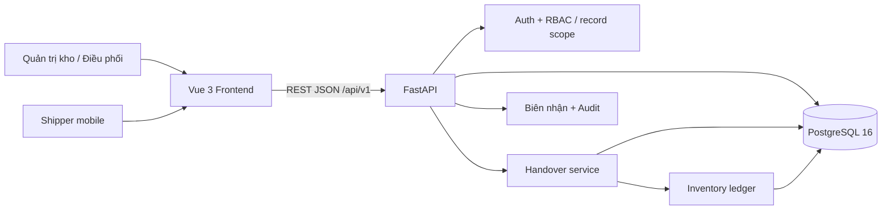
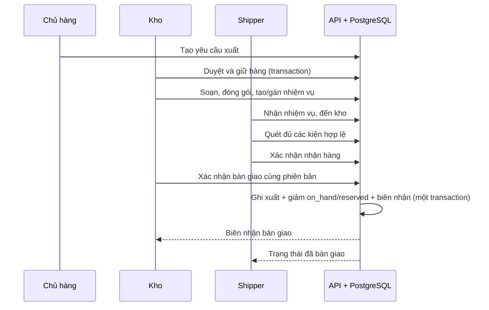
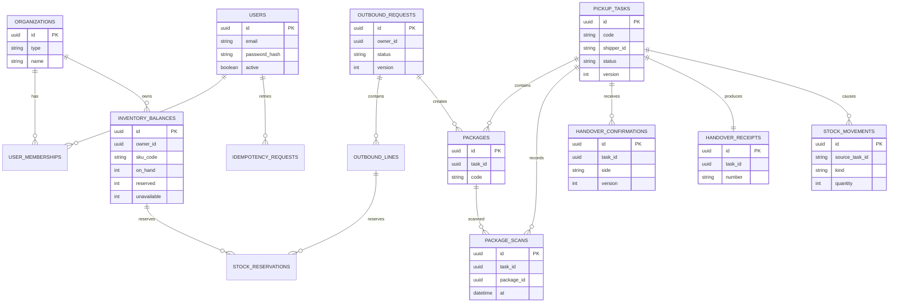
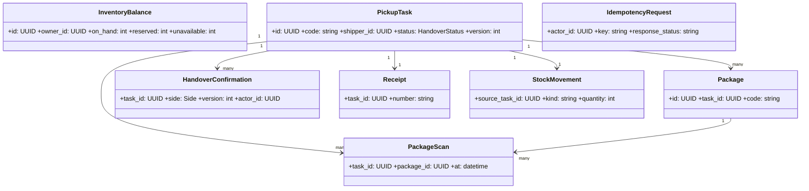

# Báo cáo xây dựng dự án DistriFlow

> Cập nhật: 23/11/2026 · Mã nguồn triển khai: [`distriflow/`](./distriflow/)

## 1. Mục tiêu và phạm vi

DistriFlow là nền tảng quản lý **bàn giao kiện điện tử tại kho** giữa kho và shipper. Nguồn yêu cầu được đọc từ thư mục `Agents`, trong đó tệp Excel là nguồn nghiệp vụ ưu tiên. Hệ thống kết thúc khi kho và shipper xác nhận bàn giao thành công; không triển khai giao hàng cuối chặng, giỏ hàng, COD, thanh toán hay định vị shipper.

Mã được xây dựng là một vertical slice P0 có thể khởi động bằng Docker, gồm giao diện Vue 3 và API FastAPI/PostgreSQL. Một số module P0/P1 rộng hơn vẫn là backlog; xem phần “Giới hạn”.

## 2. Những thay đổi đã thực hiện

| Hạng mục | Thay đổi |
|---|---|
| Kiến trúc | Tạo monorepo mới `distriflow/`, không chỉnh cơ học demo React trong `Agents` vì demo này có luồng ngoài phạm vi. |
| Frontend | Tạo Vue 3 + TypeScript + Vue Router, màn hình desktop tổng quan kho (UI01) và màn hình shipper di động (UI08–UI10). |
| Thiết kế | Áp dụng token `#087F8C`, sidebar `#172B3A`, nền `#F4F6F8`, component `StatusBadge`, responsive desktop/mobile. |
| Backend | Tạo FastAPI, SQLAlchemy và schema PostgreSQL; có seed dữ liệu local, API dashboard, nhiệm vụ shipper, nhận nhiệm vụ, đến kho, quét kiện và xác nhận hai bên. |
| An toàn nghiệp vụ | Kiểm tra nhiệm vụ đúng shipper, optimistic version, `Idempotency-Key`, không tăng tiến độ khi quét trùng/sai, và chỉ ghi xuất khi đủ hai xác nhận. |
| Vận hành | Thêm Docker Compose, Dockerfile, `.env.example`, API contract rút gọn và test quy tắc công thức tồn. |

## 3. Cấu trúc hệ thống



Luồng nghiệp vụ chính:



## 4. Sơ đồ ERD cơ sở dữ liệu



Các ràng buộc quan trọng: `packages.code` duy nhất, mỗi kiện chỉ quét một lần trong nhiệm vụ, xác nhận duy nhất theo `(task, side, version)`, một biên nhận cho một nhiệm vụ và một stock issue cho một nhiệm vụ. Công thức tồn: `on_hand = available + reserved + unavailable`; mọi lượng không âm.

## 5. Sơ đồ class (backend)



## 6. Mô tả chức năng

| Nhóm chức năng | UC / UI | Cách hoạt động | Quy tắc chính |
|---|---|---|---|
| Đăng nhập và quyền | M01.01–02 / UI13 | Xác định vai trò và phạm vi tổ chức/kho trước khi mở dữ liệu. | Backend mới là nơi quyết định quyền; không tin `owner_id` gửi từ client. |
| Danh mục | M02 / UI12 | Quản lý tổ chức, SKU, kho, shipper. | SKU/đơn vị và owner rõ ràng. |
| Nhập kho và tồn | M03–M04 / UI02–03 | Duyệt, kiểm nhận, xếp vị trí; xem tồn theo chủ hàng. | Không âm; chỉ nhập hoàn tất mới tăng tồn. |
| Yêu cầu xuất | M05–M06 / UI04, UI06 | Chủ hàng tạo yêu cầu, kho duyệt/giữ, sau đó soạn và đóng gói. | Gửi yêu cầu chưa giữ hàng; soạn/đóng gói chưa giảm tổng tồn. |
| Điều phối | M07 / UI07 | Gán shipper được chỉ định hoặc phương án điều phối được duyệt. | Không tự đổi phương án khi shipper từ chối. |
| Shipper tại kho | M08 / UI08–11 | Nhận nhiệm vụ → đến kho → quét từng kiện → xác nhận nhận hàng. | Quét sai/trùng không tăng tiến độ; QR không cấp quyền; chỉ có 4 tab mobile. |
| Bàn giao & biên nhận | M06.04, M08.04–06 | Kho và shipper xác nhận cùng phiên bản; API phát hành biên nhận. | Ghi xuất đúng một lần, retry an toàn bằng idempotency key. |
| Dashboard/báo cáo | M09 / UI01, UI14 | Hiển thị khả dụng, giữ, hàng chờ và danh sách bàn giao. | Số liệu xuất phát từ API/DB, không là biến đếm cục bộ. |

## 7. Cách chạy và kiểm tra

1. Sao chép `distriflow/.env.example` thành `distriflow/.env` và đặt mật khẩu PostgreSQL local.
2. Tại `distriflow`, chạy `docker compose -f infra/compose.yaml up --build`.
3. Mở `http://localhost:5173/admin/dashboard` hoặc `http://localhost:5173/shipper/tasks`.
4. Với shipper: nhận nhiệm vụ, đến kho, quét `PKG-001`, `PKG-002`, `PKG-003`, rồi xác nhận. API giữ trạng thái “chờ đủ xác nhận” cho đến khi kho gọi endpoint `warehouse-confirm` cùng phiên bản.

Đã chạy thành công trong workspace:

```text
python -m pytest -q                         → 1 passed
FastAPI TestClient P0 handover flow          → OK
```

Kịch bản API đã kiểm tra: nhận nhiệm vụ → đến kho → quét ba kiện → shipper xác nhận → kho xác nhận → trạng thái `handed_over`.

Các quality gate frontend/container sau đã được khai báo nhưng **chưa thể chạy trong workspace này vì không có `node`, `npm`, Docker hay PostgreSQL trên PATH**:

```bash
# frontend
npm run lint && npm run type-check && npm run test:unit && npm run build
# backend
pytest
```

## 8. Giới hạn và việc tiếp theo

- Đây là vertical slice P0, chưa hoàn chỉnh toàn bộ 50 UC: auth thực, CRUD danh mục/nhập/xuất, retailer/supplier portal, báo cáo, thông báo, Alembic migrations, audit đầy đủ và E2E còn cần triển khai.
- `X-Demo-Actor` và `create_all()` chỉ dùng cho seed local. Trước triển khai thật phải thay bằng phiên HttpOnly/CSRF hoặc OIDC, RBAC theo membership, Alembic và PostgreSQL thật; tuyệt đối không dùng header demo trong production.
- Endpoint `warehouse-confirm` đã có transaction logic mẫu; UI kho cần bổ sung màn hình chi tiết bàn giao để gọi nó bằng phiên bản trả từ server.
- Cần bổ sung integration test PostgreSQL cho cạnh tranh giữ tồn, retry idempotent, phân quyền chéo chủ hàng/shipper và mất mạng (TC03, TC06–TC09).
